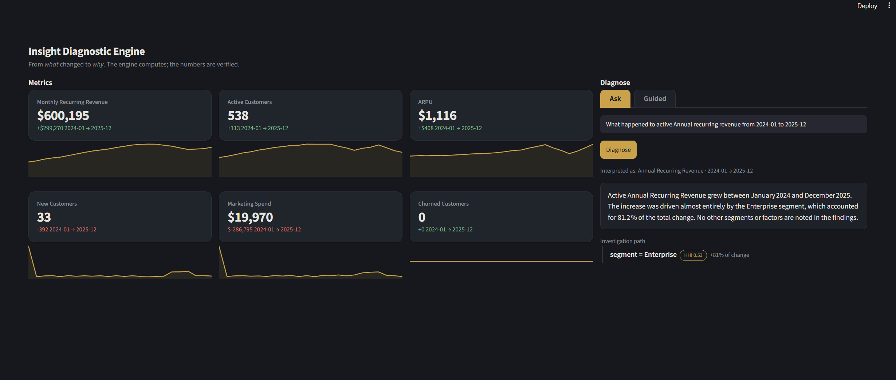
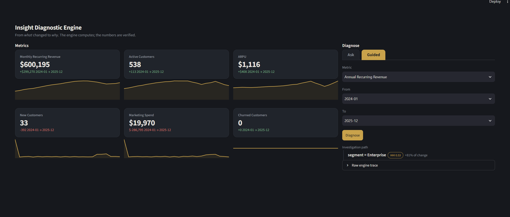
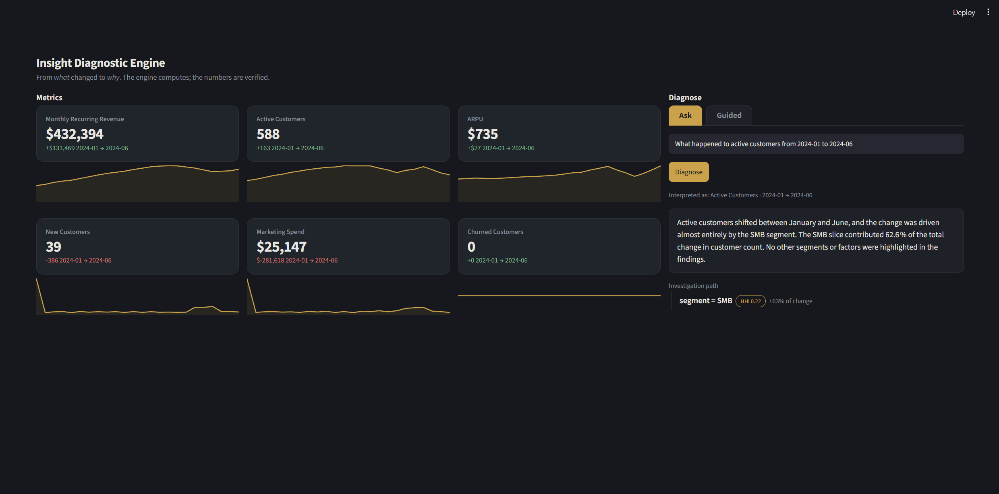

# Insight Diagnostic Engine

Ask "why did this metric move?" and get a verified answer in plain English, with the exact breakdown of what drove the change.

The core is a **portable diagnosis engine**, not a dashboard. The Streamlit app in this repo is just one way to look at it. The same engine can sit behind a Tableau or Power BI report, a web page, a Slack bot, or a scheduled email. And although this demo uses SaaS metrics (MRR, churn, ARPU), the engine is metric-agnostic, point it at any numbers in any recurring report and it works the same way.



## The one-sentence idea

A deterministic engine does all the math and produces every number. A thin LLM layer only translates your question and narrates the engine's verified result. **The LLM never does arithmetic, so the numbers are always the engine's, never the model's guess.**

## The problem it solves

Every BI tool shows you *what* changed. Almost none tell you *why*. A dashboard says revenue dropped 8 percent, and then an analyst spends an hour slicing it by segment, region, and channel to find the cause. Same manual investigation, every reporting cycle, same logic every time.

A general LLM looks like it could help, but it hallucinates numbers and writes subtly wrong queries, then explains the wrong figure with total confidence. That is the worst possible failure mode for anything people make decisions from.

This project splits the work so that never happens:

- The **engine** does all computation. It is deterministic, tested against known answers, and the only thing that produces a number.
- The **LLM** only picks what to investigate from a trusted list of metrics, and narrates a result the engine already verified.

## It is portable, and it is general

This is the part worth stressing, because it is easy to mistake the demo for the product.

**The Streamlit UI is a front end, not the engine.** The engine is a plain Python module. It takes a metric and two time periods, and returns a structured diagnosis. Anything can call it: a Streamlit app (as here), a web page via an API, a scheduled job that emails the result, a Slack bot, or a panel next to a Tableau Cloud or Power BI report. Swapping the front end does not touch the engine.

**The SaaS metrics are an example, not a limit.** The demo diagnoses MRR, churn, ARPU, and a few others because they make a clear story. But a metric is just a definition in a config file: a formula, a source table, and the dimensions it can be sliced by. Add revenue, claims, defect rates, support tickets, ad spend, whatever your business reports, and the same engine diagnoses them. Any number that shows up in a recurring report is a candidate.

So the real deliverable is the reusable "why did this move" engine. The SaaS dashboard is one demonstration of it.

## How it works

Five layers, built bottom up:

1. **Data** - two reconciled SaaS tables (revenue and acquisition costs), 24 months. Synthetic, but with deliberately planted stories so the engine's answers can be checked against a known correct answer.
2. **Semantic layer** - every metric defined once in a single config file (its formula, source table, and valid slice dimensions). The LLM can only pick metrics that exist here. It cannot invent one. This is also what makes the engine general: to support a new metric, you add a definition here, you do not change the engine.
3. **Decomposition engine** - the analytical core. Computes any metric, breaks a change down two different ways, and drills into the biggest driver under a set of guardrails.
4. **LLM layer** - two small functions. One turns a plain-English question into a metric and a time window. The other turns the engine's verified findings into plain English.
5. **UI** - the Streamlit dashboard. A KPI board that follows the selected time window, plus two ways to ask: natural language (Ask) and dropdowns (Guided, which needs no API key at all).





## Inside the engine

It breaks a change down two ways, because they answer different questions.

**"Which lever?" (factor decomposition).** Some metrics are products of others. MRR is customer count times ARPU. When MRR moves, the engine works out how much came from the volume lever (count) versus the price lever (ARPU). It uses log decomposition so the two contributions add up exactly, with no leftover cross term. This is what catches a mix shift: customers can grow while revenue falls because ARPU collapsed. A naive read would say the business is shrinking. It is not.

**"Which slice?" (dimension decomposition).** The engine splits the change across each dimension (segment, region, channel) and finds where it concentrated. Rate metrics like churn do not add up across slices, so for those it decomposes the count underneath the rate (churned customers), which does add up, and reports each slice's own rate alongside.

**Knowing when to stop.** A tool that always points a finger is wrong half the time. Three guardrails decide whether a finding is real:

- **Materiality**: ignore changes below 2.5 percent of the base. No diagnosing rounding noise.
- **Drift**: compare the change against the metric's own normal month-to-month movement, so an ordinary wobble is not reported as an event.
- **Concentration**: drilling in is gated by the Herfindahl-Hirschman Index of the breakdown. If one slice dominates, drill in. If the change is spread evenly, say "broad based" and stop, rather than inventing a single cause.

And when the headline looks flat but sub-slices are moving hard in opposite directions, the engine reports that too: a flat number hiding a tug of war, which is exactly what a dashboard watcher misses.

## The LLM layer, and a bug worth describing

The LLM does two jobs: parse the question (constrained to real metrics and validated in code), and narrate the result.

Early on, the narrator made up a number. Asked to explain an MRR drop, it confidently cited a regional figure the engine had reported as "broad based, no single driver." The engine never produced that number. The model pattern matched "there should be a regional breakdown here" and invented one.

The fix was structural, not a polite instruction. The narrator no longer sees the raw diagnosis. It sees a flat list of only the findings the engine actually stood behind, with the dead ends stripped out before the model ever reads it. There is nothing left to make up. That is the whole project in miniature: do not ask a model not to hallucinate, do not give it the material to hallucinate from.

## How it is tested

The synthetic data has four planted patterns of rising subtlety. They are the engine's test cases, each with a known correct answer:

1. **Mix shift** - MRR falls while customer count rises (expensive customers left, cheap ones arrived). Tests the volume versus price split.
2. **Single channel leak** - churn spikes, concentrated in one acquisition channel while the rest are stable. Tests finding concentration instead of a vague company-wide problem.
3. **Hidden war** - total revenue looks flat, hiding one segment growing while another collapses. Tests looking past a calm headline.
4. **Efficiency trap** - unit economics worsen because spend on a channel ballooned while the customers it bought were low value. Spans both tables. (See limitations.)

## What is not built yet

Being honest about scope:

- **Cross-table metrics** (LTV to CAC, Story 4) are defined but the engine does not yet handle a single metric spanning two tables with different grains end to end. The pieces work; the combined diagnosis does not.
- **Cohort decomposition** (breaking a change down by when customers were acquired) is designed but not built. It is a different shape of analysis and deserves its own pass.
- **The data is synthetic.** The engine is proven against known answers, which is the right way to validate it, but it has not run against a real company's data.
- **Time savings are illustrative, not measured.** This automates the repetitive first pass of an investigation. Real savings depend on deployment and are untested here.

## Tech stack

Python, pandas, DuckDB, PyYAML, Streamlit, Plotly, Pydantic, and Groq for the LLM (OpenAI compatible, the model is swappable in one line). No fine tuning. The model is grounded on the semantic layer at run time, not retrained.

## Running it

You need Python 3.11 and a Groq API key (free tier) for Ask mode. Guided mode works without a key.

```bash
# 1. create an environment and install
conda create -n insight-engine python=3.11 -y
conda activate insight-engine
pip install streamlit pandas numpy duckdb pyyaml plotly pydantic python-dotenv groq pytest

# 2. generate the synthetic data (the parquet files are not committed)
python src/generate_data.py
python src/generate_costs.py

# 3. add your Groq key for Ask mode
#    copy .env.example to .env and paste your key in
#    (Guided mode works without this step)

# 4. run
streamlit run app.py
```

Copy `.env.example` to `.env` and add your key:

```
GROQ_API_KEY=your_groq_api_key_here
```

## Author

Prithivan R
